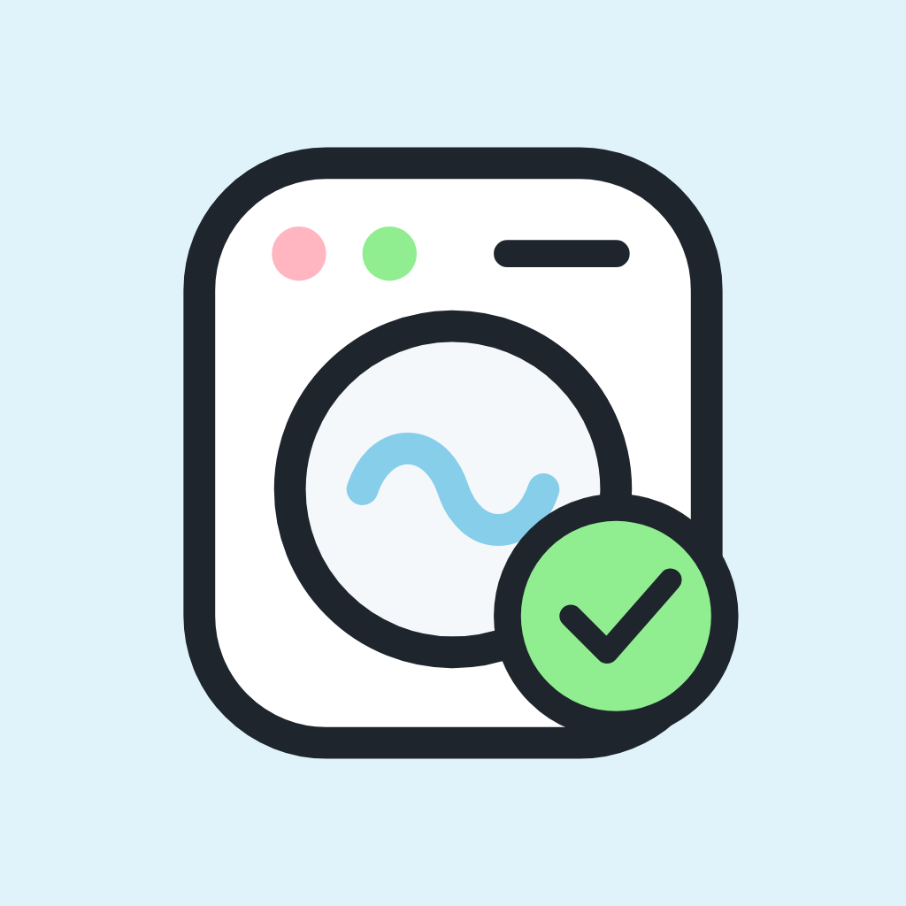
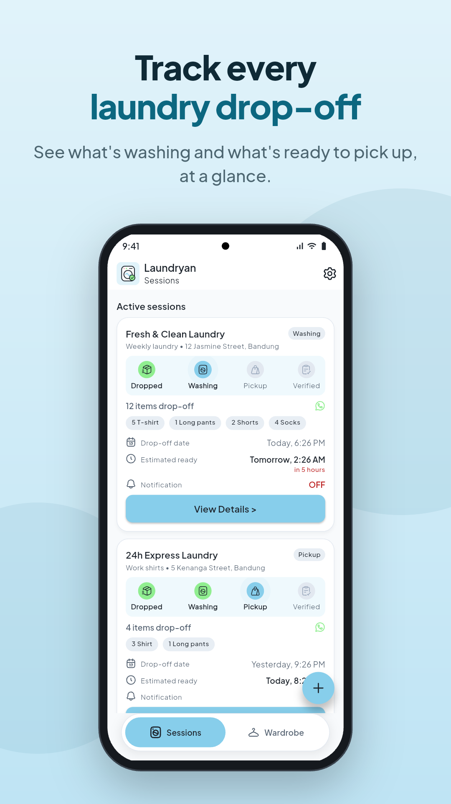
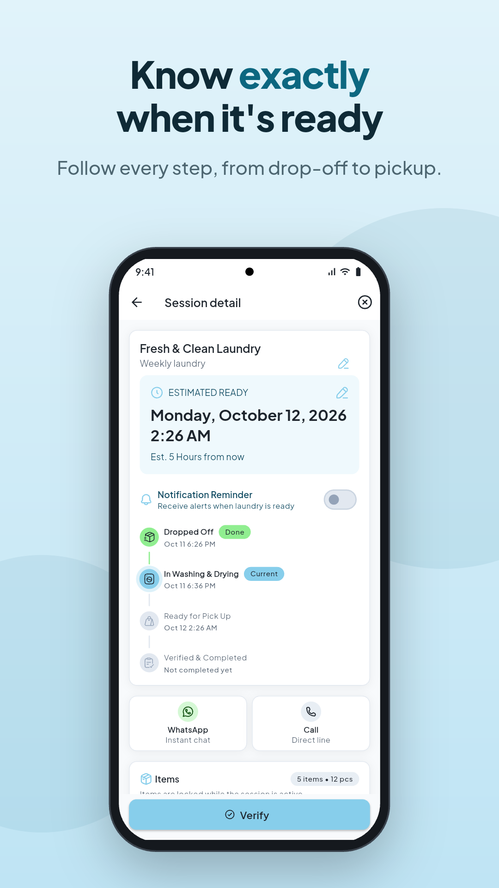
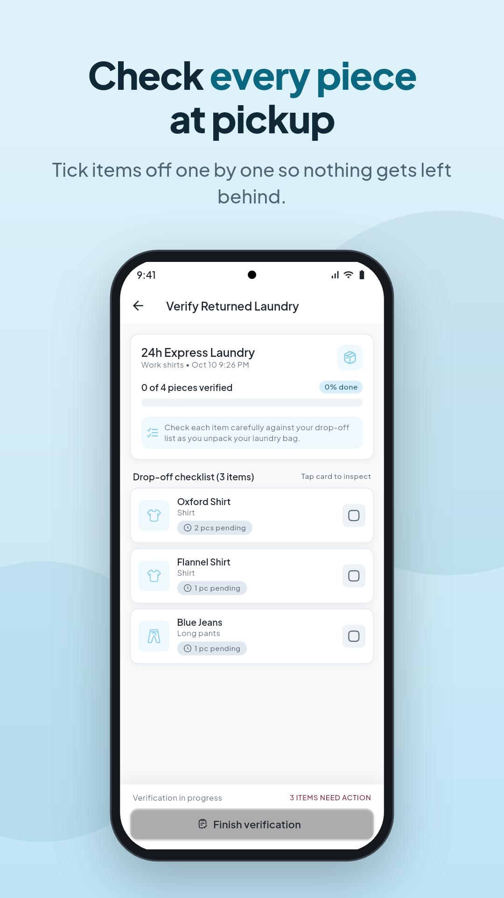
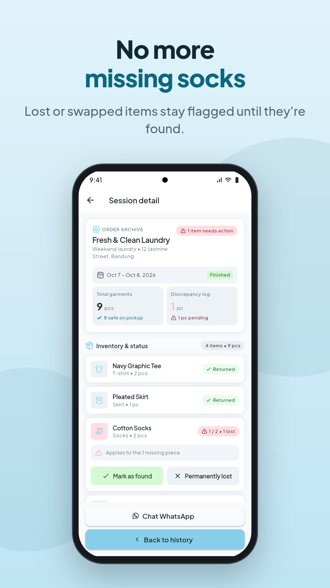
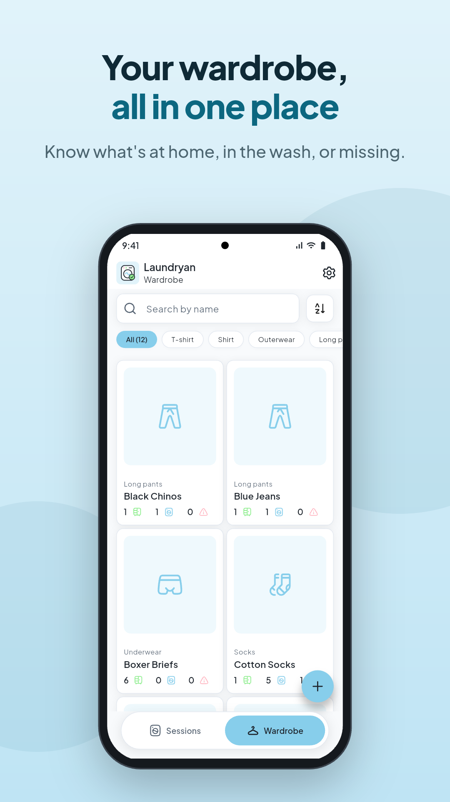
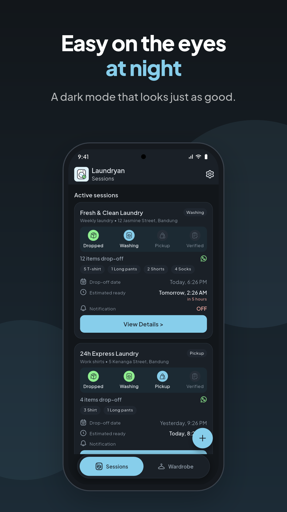

<p align="center">
  
</p>

<h1 align="center">Laundryan</h1>

<p align="center">
  <b>Track your laundry so nothing gets lost.</b>
</p>

<p align="center">
  
  
  
  
  
</p>

---

## Overview

Laundryan is a personal laundry tracker built with Flutter. It solves a
common problem: you drop your clothes off at a laundry service, and days
later you notice a shirt or a pair of socks never came back. Laundryan keeps
a photo catalog of your wardrobe and records each laundry trip as a
**session**: which items went out, where they went, and when they should be
ready. At pickup, a checklist takes you through every piece so you can mark
it as returned, lost or swapped. If anything is missing, the app writes a
WhatsApp message to the laundry listing exactly what didn't come back. All
data is stored offline on the device.

## Screenshots

<table>
  <tr>
    <td width="50%"></td>
    <td width="50%"></td>
  </tr>
  <tr>
    <td width="50%"></td>
    <td width="50%"></td>
  </tr>
  <tr>
    <td width="50%"></td>
    <td width="50%"></td>
  </tr>
</table>

## Key Features

- **Wardrobe catalog**: add clothes with a photo (camera or gallery),
  category, quantity and notes. Search by name and filter by category.
- **Laundry sessions**: log each drop-off with the laundry's name, address,
  WhatsApp number, drop-off date and estimated ready time.
- **Live session phases**: a session moves on its own from
  *Dropped → Washing → Ready for pickup → Verified*, based on the
  drop-off and ready times.
- **Pickup checklist**: check items in one by one, enter partial quantities,
  and mark pieces as *Returned*, *Lost* or *Swapped*. Available stock in
  the wardrobe updates automatically.
- **Lost item tracking**: unresolved items stay flagged in history until
  they're marked *Found* or *Permanently lost*, so wardrobe counts stay
  accurate.
- **WhatsApp and call shortcuts**: one tap opens WhatsApp with a
  pre-written message listing the missing items, or calls the laundry
  directly.
- **Ready reminders**: an optional local notification fires 2 hours before
  the estimated ready time, scheduled in the device's timezone. If
  notifications are blocked, the app says so and links to system settings.
- **Custom categories**: built-in categories (T-shirt, Shirt, Outerwear,
  Pants, Socks and more), plus your own categories with custom icons.
- **Multi-language**: English and Indonesian, with plural-aware strings.
- **Light and dark themes**, each with a matching native splash screen.
- **Offline-first**: everything lives in a local SQLite database. No
  account and no network needed.

## Tech Stack

| Package | Purpose |
| --- | --- |
| [drift](https://pub.dev/packages/drift) / [drift_flutter](https://pub.dev/packages/drift_flutter) | Reactive, type-safe SQLite database |
| [provider](https://pub.dev/packages/provider) | State management |
| [flutter_local_notifications](https://pub.dev/packages/flutter_local_notifications) | Scheduled ready reminders |
| [timezone](https://pub.dev/packages/timezone) | Timezone-aware notification scheduling |
| [flutter_timezone](https://pub.dev/packages/flutter_timezone) | Device timezone detection |
| [image_picker](https://pub.dev/packages/image_picker) | Camera and gallery photo capture |
| [path_provider](https://pub.dev/packages/path_provider) | Local photo storage |
| [url_launcher](https://pub.dev/packages/url_launcher) | WhatsApp and phone call integration |
| [shared_preferences](https://pub.dev/packages/shared_preferences) | Persistent user settings (language, theme, onboarding) |
| [hugeicons](https://pub.dev/packages/hugeicons) | Icon set |
| [google_fonts](https://pub.dev/packages/google_fonts) | Typography |
| [intl](https://pub.dev/packages/intl) + `flutter_localizations` | ARB-based localization and date formatting |
| [package_info_plus](https://pub.dev/packages/package_info_plus) | App version info |

Dev tooling: `drift_dev` + `build_runner` (code generation),
`flutter_launcher_icons`, `flutter_native_splash`, `integration_test`
(store screenshots), and `drift_db_viewer` (debug database inspection).

## Data Model

```
Categories ──< WardrobeItems ──< SessionItems >── Sessions
```

| Table | Description |
| --- | --- |
| `Categories` | Built-in or custom clothing categories with an icon |
| `WardrobeItems` | Clothing items: name, photo, category, total quantity, note |
| `Sessions` | One laundry drop-off: place, contact, dates, status, reminder |
| `SessionItems` | Items in a session: quantity sent, quantity returned, status |

Item statuses: `dibawa` (sent), `kembali` (returned), `hilang` (lost),
`tertukar` (swapped), `ditemukan` (found), `hilangPermanen` (permanently
lost).

## Project Structure

```
lib/
├── data/          # Drift database, tables, enums and repositories
├── l10n/          # ARB files (en, id) and generated localizations
├── providers/     # ChangeNotifier providers (category, session, wardrobe, settings)
├── screens/       # App screens (sessions, wardrobe, checklist, history, settings, ...)
├── utils/         # Theme, notifications, photo storage, phone and time helpers
├── widgets/       # Reusable UI components
└── main.dart      # App entry point and dependency setup
integration_test/  # Framed Play Store screenshot generator
test_driver/       # Host-side driver that saves screenshots
```

## Getting Started

### Prerequisites

- [FVM](https://fvm.app/). The project pins Flutter **3.47.2** in
  `.fvmrc`.
- Android SDK (min SDK 28) and/or Xcode for iOS.

### Installation

```bash
git clone https://github.com/andrehaliim/laundryan.git
cd laundryan
fvm install
fvm flutter pub get
```

### Code generation

Regenerate the Drift database code after changing `lib/data/tables.dart`:

```bash
fvm dart run build_runner build --delete-conflicting-outputs
```

Localizations in `lib/l10n/` are regenerated automatically on
`pub get` / build (`generate: true` in `pubspec.yaml`).

### Run

```bash
fvm flutter run
```

VS Code launch configurations for debug, profile and release are included
in `.vscode/launch.json`.

## Building for Release

Android release builds **require** an upload keystore. Create
`android/key.properties`:

```properties
storePassword=<store password>
keyPassword=<key password>
keyAlias=<key alias>
storeFile=<path to upload-keystore.jks>
```

Then build:

```bash
fvm flutter build appbundle
```

The build fails with an error if `key.properties` is missing, instead of
silently signing with the debug key. See the
[Flutter Android deployment guide](https://docs.flutter.dev/deployment/android#sign-the-app).

## Store Screenshots

Framed 1080×1920 Play Store screenshots for every supported language are
generated with seeded demo data:

```bash
fvm flutter drive --driver=test_driver/integration_test.dart \
  --target=integration_test/screenshots_test.dart -d <device>
```

Framed images are written to `screenshots/<lang>/` and bare screens to
`screenshots/<lang>/raw/`.

## Author

**Andre Haliim**: [andrehaliim.vercel.app](https://andrehaliim.vercel.app)

## License

This project is licensed under the [MIT License](LICENSE).
